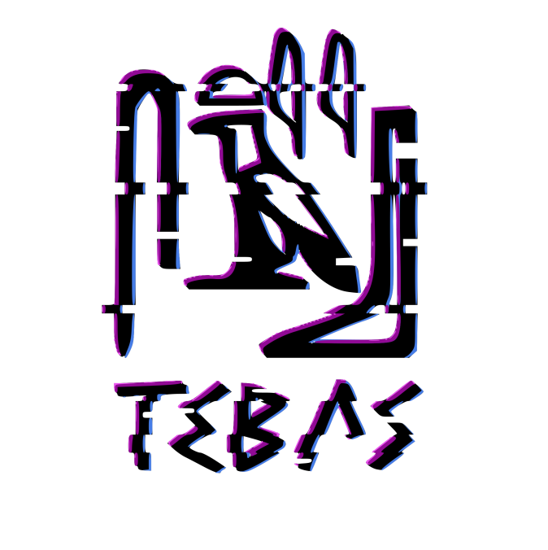

# 🏛️ Tebas

### Um Repositório de Conhecimento em Cibersegurança

Uma coleção de recursos, anotações técnicas, exemplos e materiais de estudo para apoiar o aprendizado contínuo em segurança da informação.

  

  <a href="#-sobre-o-projeto">Sobre o Projeto</a> •
  <a href="#-estrutura-do-repositório">Estrutura</a> •
  <a href="#-como-começar">Como Começar</a> •
  <a href="#-como-contribuir">Contribuições</a>

---

## 📖 Sobre o Projeto

O Tebas nasceu da iniciativa de estudantes universitários que compartilhavam um interesse em comum: explorar, aprender e descobrir cada vez mais sobre o mundo da cibersegurança.

A ideia é reunir, em um só lugar, materiais de estudo, experiências práticas e descobertas sobre diferentes áreas da segurança da informação, criando um espaço para compartilhar conhecimento e aprender juntos.

Seja você alguém que está dando os primeiros passos na cibersegurança ou alguém que já tem experiência na área, o Tebas é um espaço para aprender, explorar novas possibilidades e manter viva a curiosidade por tudo que envolve segurança digital.

### 🎯 Objetivos

- 📚 **Centralizar o conhecimento:** reunir recursos de estudo em cibersegurança em um único lugar.
- 🔍 **Explorar conceitos de segurança:** incentivar o aprendizado por meio de exemplos técnicos e conteúdos específicos.
- 🧠 **Apoiar o aprendizado contínuo:** construir uma base de referência para consultas e estudos futuros.
- 🤝 **Compartilhar conhecimento:** disponibilizar recursos úteis para a comunidade de segurança da informação.

## 🗂️ Estrutura do Repositório

O repositório está organizado em diretórios temáticos, permitindo encontrar materiais de acordo com a área de interesse.

| Diretório | Descrição |
|---|---|
| [`criptography/ciphers/`](criptography/ciphers/) | Materiais de estudo relacionados à criptografia e às cifras. |
| [`forense/png/`](forense/png/) | Recursos de perícia forense digital relacionados a arquivos PNG. |
| [`web/Same_Origin_Policy/`](web/Same_Origin_Policy/) | Conceitos de segurança web relacionados à Política de Mesma Origem (*Same-Origin Policy*). |

Outros recursos e arquivos de apoio também podem estar disponíveis na raiz do repositório.

## 🧭 Como Começar

Não é necessário instalar nenhum software para consultar os materiais diretamente pelo GitHub.

1. **Explore o repositório:** navegue pelos diretórios e identifique os assuntos de seu interesse.
2. **Escolha um tema:** acesse a pasta correspondente e consulte os arquivos disponíveis.
3. **Estude o conteúdo:** leia a documentação e analise os exemplos fornecidos.
4. **Aprofunde seus conhecimentos:** utilize os materiais como ponto de partida para novas pesquisas e experimentações.

## 🛡️ Uso Responsável

O conhecimento em cibersegurança deve ser utilizado de maneira ética e responsável.

Não utilize técnicas ou exemplos deste repositório contra sistemas, redes, contas ou dados de terceiros sem a devida autorização.

Respeite a legislação aplicável, as boas práticas de segurança e as regras dos ambientes utilizados para estudo e experimentação.

## 🤝 Como Contribuir

O compartilhamento de conhecimento fortalece a comunidade de cibersegurança.

Contribuições que melhorem a organização, a clareza, a precisão e a utilidade dos materiais são bem-vindas.

Algumas formas de contribuir:

- Adicionar novos materiais de estudo sobre cibersegurança.
- Melhorar a documentação e as explicações existentes.
- Organizar os recursos em diretórios temáticos mais claros.
- Corrigir erros ou atualizar conteúdos desatualizados.
- Compartilhar referências para documentações técnicas relevantes.

### Fluxo de contribuição

1. Faça um *fork* do repositório.
2. Crie uma branch para suas alterações.
3. Adicione novos materiais ou aprimore os existentes.
4. Revise as alterações, verificando a precisão técnica, a clareza e a atribuição adequada das fontes.
5. Abra um *pull request*, explicando as mudanças realizadas e seus objetivos.

Evite incluir credenciais, informações privadas, materiais protegidos por direitos autorais sem a devida autorização ou instruções destinadas a facilitar atividades não autorizadas.

---

  <i>"Ensinar não é transferir conhecimento, mas criar as possibilidades para a sua produção ou a sua construção."</i>
   
  <b> - Paulo Freire</b>

